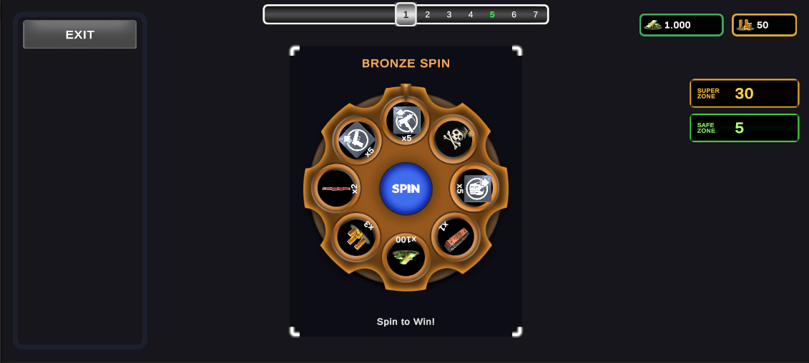
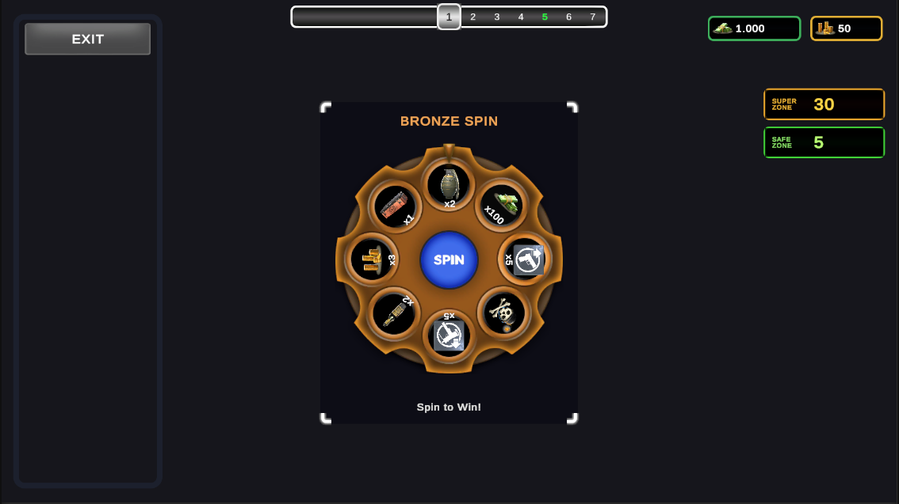
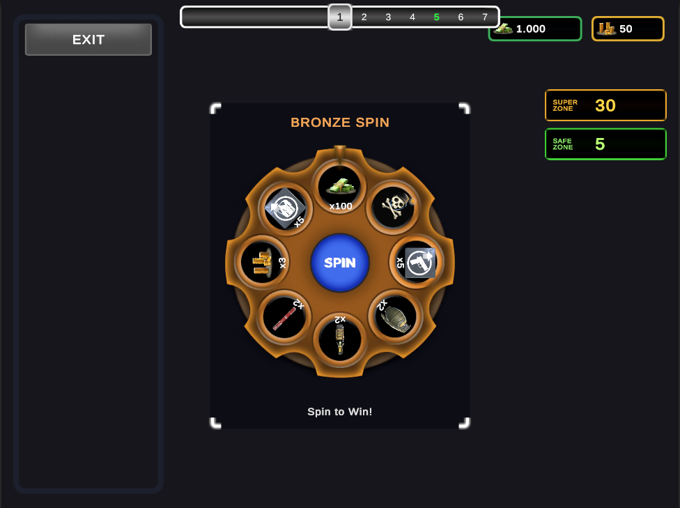
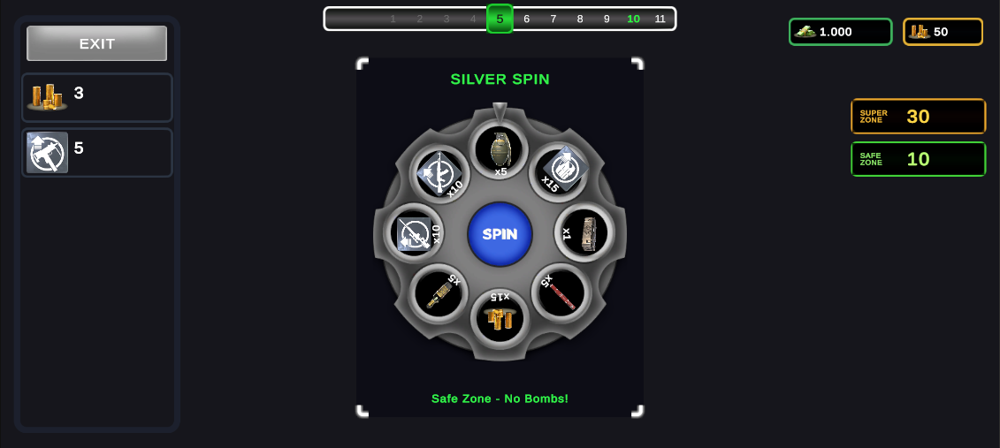
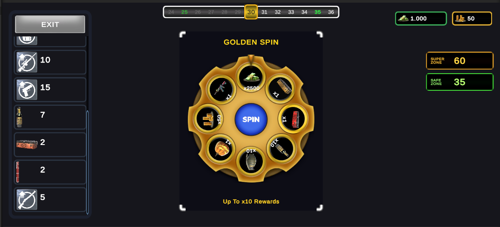
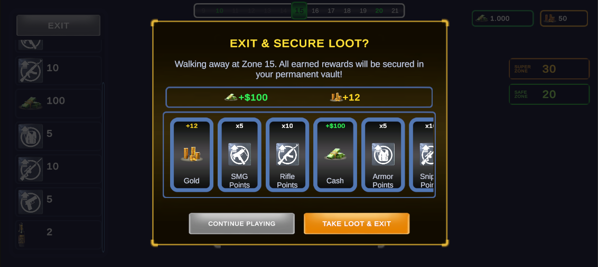
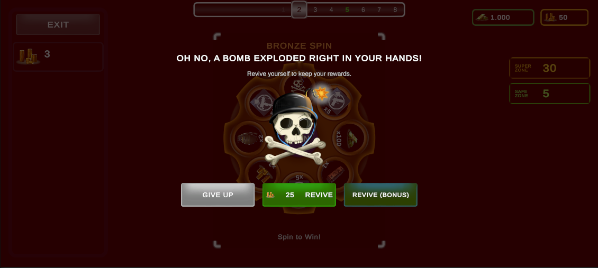
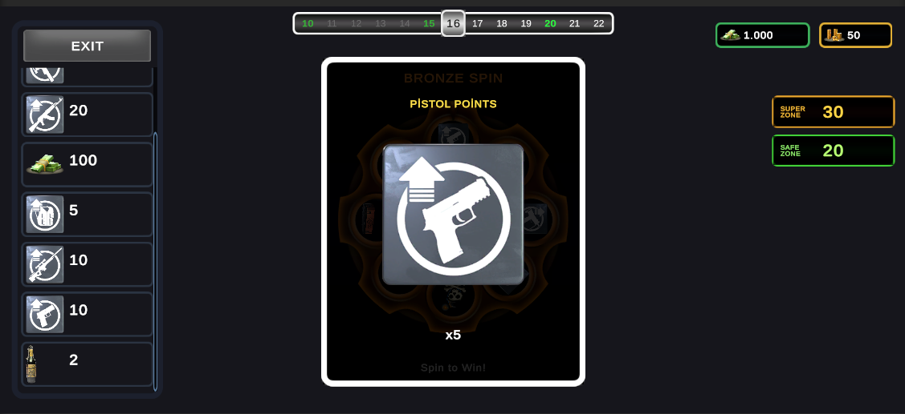

# 🎡 Wheel of Fortune — Mobile Game Demo

[](https://unity.com/)
[]()
[]()
[](https://github.com/HakanKestir/SpinTheWheelGame/releases/latest)

> **Game Developer Demo — Case Study**  
> An interactive, responsive, and data-driven **Wheel of Fortune** mobile game inspired by modern card and fortune mini-game mechanics. Developed with modern Unity best practices, clean decoupled architecture, and optimized mobile UI.

---

## 📦 Deliverables & Quick Links

- 📥 **Android APK Release:** [Download Latest APK on GitHub Releases](https://github.com/HakanKestir/SpinTheWheelGame/releases/latest)
- 📦 **Direct APK File:** [`Release.apk`](Release.apk) *(41.8 MB, Android Release build)*
- 🎬 **Gameplay Video:** [Watch Demonstration](#-gameplay-video-demonstration)
- 📱 **Multi-Aspect Ratio Support:** [Screenshots (20:9, 16:9, 4:3)](#-responsive-multi-aspect-ratio-support)
- 🧪 **Editor Test Suite:** [Automated Verification](#-automated-testing--verification)

---

## 🎬 Gameplay Video Demonstration

[](docs/media/gameplay_demo.mp4)

> 🎥 **Direct Video File:** [`docs/media/gameplay_demo.mp4`](docs/media/gameplay_demo.mp4) *(42.5 MB, Full HD)*  
> *Click the preview thumbnail above or the link to open the video file showing Bronze spins, Safe Zone progression, revive options, and exit banking.*

<video src="docs/media/gameplay_demo.mp4" controls width="100%"></video>

---

## 📱 Responsive Multi-Aspect Ratio Support

The UI is built with a single responsive Canvas Scaler set to **`Expand`** mode (`m_ScreenMatchMode: 2`), ensuring layout stability, no off-center clipping, and zero black bars across ultra-wide, standard, and tablet displays.

| Ultra-Wide (20:9 / 2400×1080) | Standard (16:9 / 1920×1080) | Tablet / Foldable (4:3 / 2048×1536) |
| :---: | :---: | :---: |
|  |  |  |
| *Modern Android flagships* | *Standard mobile & landscape devices* | *iPads, Android tablets, foldables* |

---

## 📸 In-Game Screenshots & Features

### 1. Wheel Tiers & Zone Progression
| Standard Bronze Wheel (Zones 1–4, 6–9...) | Safe Zone Silver Wheel (Zones 5, 10, 15...) | Super Zone Golden Wheel (Zone 30, 60...) |
| :---: | :---: | :---: |
|  |  |  |
| *8 Slices: 7 Rewards + 1 Bomb* | *8 Slices: High-tier rewards, 0 Bombs* | *8 Slices: Premium legendary loot, 0 Bombs* |

### 2. Modals, Economy & Celebrations
| Exit & Secure Loot Confirmation | Bomb Encounter (Death / Revive) | Winner Celebration Card Popup |
| :---: | :---: | :---: |
|  |  |  |
| *Side-scrolling tray of banked vault loot* | *Revive via 25 Gold, Bonus Ad, or Give Up* | *Dynamic flying currency particles & punch anim* |

---

## 🎮 Game Rules & Specifications

### 1. Wheel Hierarchy & Slice Logic
| Tier | Interval | Slice Count | Bomb Count | Rewards |
| :--- | :--- | :---: | :---: | :--- |
| **Bronze Wheel** | Default Zones (1–4, 6–9, etc.) | 8 | **1 Bomb** | 7 rewards dynamically rolled from custom Bronze pool. |
| **Silver Wheel** | **Safe Zones** (every 5th: 5, 10, 15, 20...) | 8 | **0 Bombs** | 8 high-tier rewards dynamically rolled from Silver pool. |
| **Golden Wheel** | **Super Zones** (every 30th: 30, 60...) | 8 | **0 Bombs** | 8 premium rewards dynamically rolled from Golden pool. |

- **Editor-Changeable Slices:** Slice configs, reward icons, amounts, and weighted probabilities are fully configurable from the editor via ScriptableObjects (`BronzeWheelConfig`, `SilverWheelConfig`, `GoldenWheelConfig`, and `RewardDatabase`).

### 2. Zone Progression & Reward Multipliers
- Progressive zone tracker displays current zone number, completed zones, upcoming safe/super milestones, and right-hand milestone badges.
- **Configurable Multipliers:** Reward multiplication escalates by +1x every $N$ zones (e.g. 1x at Z1–Z4, 2x at Z5–Z8, etc.) or can be toggled off directly in `MainZoneConfig.asset`.
- **Super Zone Target Preview:** Preview badge in the header shows the upcoming Super Zone grand prize.

### 3. Bomb Encounter & Revive Options
When landing on a bomb slice:
1. **Revive with Gold:** Spend 25 Gold to disarm the bomb, keep all collected loot, and advance to the next zone.
2. **Revive Bonus:** Free evaluation revive option for reviewers.
3. **Give Up:** Forfeit all rewards collected in the current run and reset to Zone 1.

### 4. Exit Rules & Permanent Vault Banking
- **Safe Zone Exit Restriction:** Can be enabled/disabled via `Restrict Exit To Safe/Super Zones` in `MainZoneConfig.asset`. When enabled, the player can only exit at Safe (5, 10...) or Super (30) zones; the Exit button is disabled outside safe zones.
- **Permanent Vault:** Walking away banks all earned Cash and Gold to the permanent wallet **and** securely archives all weapons, chests, upgrade points, and consumables into the persistent player inventory vault.

---

## 🏗️ Architecture & Code Quality

The project adheres to Clean Code and SOLID principles:

```
Assets/
├── Atlases/              # Optimized SpriteAtlas (WheelGameAtlas)
├── Data/                 # ScriptableObjects (RewardDatabase, WheelConfigs, MainZoneConfig)
├── Prefabs/              # Reusable Modular UI Prefabs (Core, Wheel, Rewards, Zone, Header, Modals)
├── Scenes/               # SampleScene (Production scene)
├── Scripts/
│   ├── Core/             # Domain & Managers (GameFlowManager, ZoneProgressionManager, PlayerInventoryManager, WheelSpinController)
│   ├── Data/             # ScriptableObject definitions (RewardItemSO, WheelConfigSO, ZoneConfigSO)
│   ├── Editor/           # Custom Inspectors & Automated Verification Suites
│   └── UI/
│       ├── Common/       # UIAutoBinder (Reflection-free automatic UI wiring & raycast optimizers)
│       ├── Header/       # Top header, currency indicators, super zone preview
│       ├── Modals/       # Exit/CashOut Modal, Bomb Modal, Card Item Views
│       ├── Rewards/      # Rewards Tray View, Celebration Card Popup, Flying Tokens
│       ├── Wheel/        # UIWheelView, Slice Views, Needle Indicator, UISpinButtonAnimator
│       └── Zone/         # Zone Tracker Bar, Zone Number Item View
```

### Key Technical Implementations
- **Event-Driven Decoupling:** Managers and UI views communicate strictly via C# events and Actions (`OnStateChanged`, `OnRewardWon`, `OnZoneChanged`, `OnRunRewardsBanked`), preventing tight coupling.
- **RaycastTarget & Maskable Optimization:** Audited and optimized per case study guidelines. All decorative images, backgrounds, slice icons, and card elements have `raycastTarget = false`. Only actionable buttons, scroll viewports, and modal backdrops retain raycasting.
- **Separated Animator Transforms:** UI animators (such as `UISpinButtonAnimator`) animate child content transforms rather than root transforms, preventing layout corruption and layout recalculation spikes.
- **9-Slice Sprite Precision:** Exact border parameters configured on frames to prevent stretching and 9-slice warnings.
- **Memory & Draw Call Batching:** All wheel elements, icons, and frames are batched under `WheelGameAtlas.spriteatlas`.

---

## 🧪 Automated Testing & Verification

Custom Editor test runners are included under the Unity top menu bar:

### 1. Exit Modal & Banking Test Suite
- **Menu:** `Wheel Of Fortune` > `Run Exit Modal & Banking Tests`
- **Script:** [`ExitModalVerificationTest.cs`](Assets/Scripts/Editor/ExitModalVerificationTest.cs)
- **Validates:**
  - Safe Zone exit restriction logic (`CanLeaveAtZone(1)` vs `CanLeaveAtZone(5)` and `CanLeaveAtZone(30)`).
  - 1st-click exit button responsiveness and prompt display.
  - Run loot retention during prompt.
  - Accurate currency banking to permanent wallet.
  - Non-currency item retention in persistent vault.
  - Zone and state resets upon cashing out.

### 2. Reward Pool & Multiplier Test Suite
- **Menu:** `Wheel Of Fortune` > `Run Dynamic Wheel & Multiplier Tests`
- **Script:** [`RewardPoolVerificationTest.cs`](Assets/Scripts/Editor/RewardPoolVerificationTest.cs)
- **Validates:**
  - All 20 items in `RewardDatabaseSO`.
  - Dynamic Bronze rolling (exactly 1 bomb and 7 rewards).
  - Safe and Super wheel integrity (0 bombs across trials).
  - Multiplier increment intervals and disabled toggle behavior.

---

## 🚀 How to Run in Unity Editor

1. Open project in **Unity 6** (`6000.3.25f1`).
2. Open scene `Assets/Scenes/SampleScene.unity`.
3. In the **Game View**, set aspect ratio to **16:9**, **20:9**, or **4:3**.
4. Press **Play**:
   - Click **SPIN** to spin the wheel.
   - When landing on a reward, watch the celebration card popup and flying token animations.
   - Use the **Exit Button** on the left tray to cash out and bank loot to your permanent vault.
   - Land on a **Bomb** slice on Bronze wheels to test revive options.

---

## 👨‍💻 Developer Notes
Developed as a comprehensive mobile game developer demonstration. All visual assets and styling rules were strictly implemented according to technical and design guidelines.
